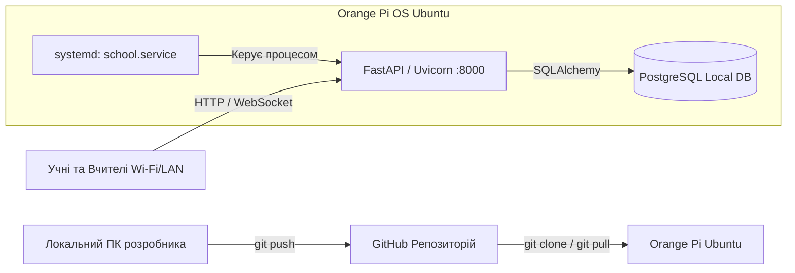

# Requirements

### Overview & Goals
Мета — забезпечити надійне, швидке та ресурсоефективне розгортання шкільної платформи на одноплатному комп'ютері **Orange Pi** під керуванням **Ubuntu OS** із синхронізацією вихідного коду через **GitHub**.

### Scope
- **In Scope:**
  - Підготовка локального проєкту: налаштування `.gitignore`, ініціалізація Git, створення репозиторію на GitHub та завантаження коду.
  - Підготовка операційної системи Ubuntu на Orange Pi (встановлення Python, Git, PostgreSQL та системних залежностей).
  - Налаштування оточення, ізольованого `venv` та конфігураційних змінних `.env`.
  - Створення та активація фонового демона `systemd` для забезпечення безперервної роботи (24/7) та автозапуску після перезавантаження плати.
  - Налаштування механізму отримання та застосування оновлень через GitHub (`git pull`).
- **Out of Scope:**
  - Встановлення образу Ubuntu на SD-карту / eMMC плати Orange Pi (вважається, що базову ОС вже інстальовано).
  - Налаштування статичної білої IP-адреси провайдера (для доступу ззовні достатньо локальної мережі або ngrok/Cloudflare Tunnel).

### User Stories
- **Як розробник / вчитель**, я хочу завантажувати зміни коду в репозиторій GitHub за допомогою однієї команди `git push`, щоб мати централізоване збереження версій.
- **Як адміністратор сервера (Orange Pi)**, я хочу розгорнути застосунок шляхом клонування з GitHub та налаштувати сервіс автозапуску, щоб сервер самостійно підіймався після увімкнення живлення плати без потреби ручного входу по SSH.
- **Як користувачі (учні та вчителі)**, ми хочемо мати стабільний цілодобовий доступ до платформи в локальній мережі школи або через Wi-Fi точку доступу.

### Functional Requirements
- Код застосунку повинен безпечно зберігатися на GitHub без службових файлів IDE та тимчасових кешів.
- На платі Orange Pi має бути розгорнуто локальний сервер PostgreSQL, а таблиці й початкові 300 завдань повинні автоматично ініціалізуватися при першому старті.
- Застосунок повинен слухати адресу `0.0.0.0:8000` (або вказаний у `.env` порт), забезпечуючи доступність для всіх пристроїв у локальній мережі.
- Сервіс має автоматично відновлювати роботу при збоях (`Restart=always` у systemd).

# Technical Design

### Current Implementation
- **Технологічний стек:** FastAPI (Python 3.10+), Uvicorn, SQLAlchemy 2.0, PostgreSQL (asyncpg/psycopg2), Jinja2, WebSockets.
- **Точка входу:** `main.py` або `run.sh`, конфігурація зчитується з `app/config.py` через змінні середовища (`POSTGRES_USER`, `POSTGRES_PASSWORD`, `POSTGRES_DB`, `POSTGRES_HOST`, `POSTGRES_PORT`, `PORT`, `HOST`, `TEACHER_PASSWORD`, `SECRET_KEY`).
- **База даних:** автоматична ініціалізація схеми та наповнення даними (`app/seed_data.py`) при старті сервера.

---

### Key Decisions
1. **Вибір середовища запуску (Native systemd + venv):**
   - *Рішення:* Використання системного `python3-venv` разом із `systemd` сервісом.
   - *Обґрунтування:* Одноплатні комп'ютери Orange Pi (особливо моделі з 1–2 ГБ RAM) мають обмежені ресурси. Прямий запуск через віртуальне середовище мінімізує оверхед пам'яті й процесора в порівнянні з важкими контейнерами, гарантує швидкий старт і простоту налагодження.
2. **Керування конфігурацією через `.env`:**
   - *Рішення:* Використання файлу `.env` на Orange Pi для збереження паролів і портів замість хардкоду.
   - *Обґрунтування:* Безпека даних, відсутність чутливих паролів у публічному репозиторії GitHub.

---

### Step-by-Step Execution Guide (Повна інструкція)

#### Етап 1. Заливка проєкту на GitHub (з вашого комп'ютера)

1. **Створення файлу `.gitignore` у корені проєкту:**
   Створіть файл `.gitignore`, якщо він відсутній:
   ```gitignore
   .idea/
   .vscode/
   __pycache__/
   */__pycache__/
   *.pyc
   venv/
   .env
   .DS_Store
   ```

2. **Ініціалізація Git та перший коміт:**
   Відкрийте термінал у папці проєкту (`school`):
   ```bash
   git init
   git add .
   git commit -m "feat: initial commit of school platform"
   ```

3. **Створення репозиторію на GitHub:**
   - Перейдіть на [github.com](https://github.com) -> **New repository**.
   - Назвіть репозиторій (наприклад, `school-platform`).
   - Виберіть *Public* або *Private*. Не додавайте README чи .gitignore (вони вже є локально).

4. **Прив'язка та вивантаження коду:**
   ```bash
   git branch -M main
   git remote add origin https://github.com/<ВАШ_ЮЗЕРНЕЙМ>/<ВАШ_РЕПОЗИТОРІЙ>.git
   git push -u origin main
   ```

---

#### Етап 2. Підготовка Orange Pi (Ubuntu OS)

1. **Підключення до Orange Pi по SSH:**
   ```bash
   ssh <username>@<orange_pi_ip>
   ```

2. **Оновлення системи та встановлення системних пакунків:**
   ```bash
   sudo apt update && sudo apt upgrade -y
   sudo apt install -y python3 python3-pip python3-venv git postgresql postgresql-contrib libpq-dev build-essential
   ```

3. **Налаштування PostgreSQL:**
   Увійдіть у консоль PostgreSQL та створіть користувача і базу:
   ```bash
   sudo -u postgres psql
   ```
   Виконайте SQL-команди:
   ```sql
   CREATE USER school WITH PASSWORD '123456';
   CREATE DATABASE school OWNER school;
   GRANT ALL PRIVILEGES ON DATABASE school TO school;
   \q
   ```
   *(Примітка: за замовчуванням PostgreSQL в Ubuntu слухає порт `5432`. Ви можете використовувати порт 5432 або змінити конфігурацію postgresql.conf на 5050).*

---

#### Етап 3. Розгортання проєкту на Orange Pi через GitHub

1. **Клонування репозиторію:**
   ```bash
   cd ~
   git clone https://github.com/<ВАШ_ЮЗЕРНЕЙМ>/<ВАШ_РЕПОЗИТОРІЙ>.git school
   cd school
   ```

2. **Створення та активація віртуального середовища Python:**
   ```bash
   python3 -m venv venv
   source venv/bin/activate
   pip install --upgrade pip
   pip install -r requirements.txt
   ```

3. **Створення файлу конфігурації `.env`:**
   ```bash
   nano .env
   ```
   Вставте параметри:
   ```ini
   POSTGRES_USER=school
   POSTGRES_PASSWORD=123456
   POSTGRES_DB=school
   POSTGRES_HOST=localhost
   POSTGRES_PORT=5432
   PORT=8000
   HOST=0.0.0.0
   TEACHER_PASSWORD=123456
   SECRET_KEY=orange-pi-production-secret-key-2026
   ```
   *(Збережіть: `Ctrl+O`, `Enter`, вихід: `Ctrl+X`).*

4. **Тестовий запуск:**
   ```bash
   python3 main.py
   ```
   Перевірте в браузері комп'ютера/телефона: `http://<orange_pi_ip>:8000`. Якщо все працює — зупиніть комбінацією `Ctrl+C`.

---

#### Етап 4. Налаштування автозапуску через systemd

1. **Створення юніта сервісу:**
   ```bash
   sudo nano /etc/systemd/system/school.service
   ```
   Вміст файлу (замініть `<username>` на ім'я вашого користувача в Ubuntu, наприклад `orangepi` або `ubuntu`):
   ```ini
   [Unit]
   Description=School Platform FastAPI Application
   After=network.target postgresql.service
   Wants=postgresql.service

   [Service]
   Type=simple
   User=<username>
   WorkingDirectory=/home/<username>/school
   EnvironmentFile=/home/<username>/school/.env
   ExecStart=/home/<username>/school/venv/bin/python main.py
   Restart=always
   RestartSec=5
   StandardOutput=journal
   StandardError=journal

   [Install]
   WantedBy=multi-user.target
   ```

2. **Активація та запуск сервісу:**
   ```bash
   sudo systemctl daemon-reload
   sudo systemctl enable school.service
   sudo systemctl start school.service
   ```

3. **Перевірка стану сервісу:**
   ```bash
   sudo systemctl status school.service
   ```

---

#### Етап 5. Оновлення застосунку з GitHub у майбутньому

Для швидкого оновлення застосунку після пушу нового коду на GitHub створено зручний скрипт `deploy.sh`:

1. **Створення скрипту `deploy.sh` у папці `/home/<username>/school/`:**
   ```bash
   nano deploy.sh
   ```
   ```bash
   #!/usr/bin/env bash
   set -e
   echo "=== Оновлення платформи з GitHub ==="
   git pull origin main
   source venv/bin/activate
   pip install -r requirements.txt
   sudo systemctl restart school.service
   echo "=== Застосунок успішно оновлено та перезапущено ==="
   ```
2. **Надання прав на виконання:**
   ```bash
   chmod +x deploy.sh
   ```
3. **Виконання оновлення однією командою:**
   ```bash
   ./deploy.sh
   ```

---

### Architecture Diagram



# Testing

### Validation Approach
Перевірка коректності виконання інструкції проводиться послідовно на кожному етапі за допомогою стандартних перевірочних команд та тестів доступності сервісів.

### Key Scenarios
1. **Валідація репозиторію на GitHub:**
   - Перевірити доступність репозиторію за адресою `https://github.com/<user>/<repo>`.
   - Переконатися, що папки `.idea/`, `.env`, та `__pycache__/` відсутні у списку файлів на GitHub.
2. **Валідація підключення до PostgreSQL на Orange Pi:**
   - Виконати перевірку статусу служби: `sudo systemctl status postgresql`.
   - Перевірити автентифікацію: `PGPASSWORD=123456 psql -h localhost -U school -d school -c "SELECT 1;"`.
3. **Валідація роботи FastAPI сервісу через systemd:**
   - Перевірити статус: `sudo systemctl status school.service` (повинен бути `active (running)`).
   - Перевірити журнал логів: `journalctl -u school.service -n 50 -f`.
4. **Валідація доступу клієнтів у локальній мережі:**
   - Надіслати запит: `curl -I http://localhost:8000/`.
   - Відкрити браузер на смартфоні або ноутбуці за адресою `http://<orange_pi_ip>:8000`.
   - Перевірити вхід учня у довільний кабінет та вхід вчителя у кабінет моніторингу за паролем `123456`.
5. **Валідація автозапуску при перезавантаженні:**
   - Виконати `sudo reboot` на Orange Pi.
   - Після відновлення зв'язку перевірити доступність сайту без ручного введення команд.
6. **Валідація процесу оновлення:**
   - Зробити тестову зміну на ПК, завантажити в GitHub (`git push`).
   - На Orange Pi виконати `./deploy.sh` та перевірити застосування змін.

# Delivery Steps

###   Step 1: Підготовка локального репозиторію та публікація на GitHub
Підготувати локальний проєкт до публікації та завантажити його у віддалений репозиторій на GitHub.

- Створити файл `.gitignore` з виключенням `.idea/`, `__pycache__/`, `.env`, віртуальних середовищ `venv/` та тимчасових файлів.
- Ініціалізувати локальний Git-репозиторій (`git init`), додати всі файли проєкту та зафіксувати початковий коміт.
- Створити новий репозиторій на GitHub (публічний або приватний).
- Додати віддалену адресу `origin` та виконати `git push -u origin main`.

###   Step 2: Налаштування оточення та СУБД PostgreSQL на Orange Pi
Підготувати операційну систему Ubuntu на Orange Pi, встановити системні залежності та налаштувати СУБД.

- Оновити системні пакунки на Orange Pi (`apt update && apt upgrade`).
- Встановити Python 3, `python3-pip`, `python3-venv`, `git`, `libpq-dev` та сервер `postgresql`.
- Налаштувати PostgreSQL: створити користувача `school`, базу даних `school` та надати права доступу.
- Налаштувати параметри підключення (порт 5050 або стандартний 5432) відповідно до конфігурації застосунку.

###   Step 3: Розгортання застосунку та налаштування systemd-сервісу
Завантажити код із GitHub на Orange Pi, встановити бібліотеки та налаштувати сервіс автозапуску.

- Схилити репозиторій на плату через `git clone`.
- Створити ізольоване віртуальне середовище `python3 -m venv venv` та встановити залежності з `requirements.txt`.
- Створити файл `.env` із робочими параметрами підключення до БД, портом та паролем вчителя.
- Створити юніт-файл `systemd` (`/etc/systemd/system/school.service`) для автоматичного старту сервісу при завантаженні системи та перезапуску у разі збоїв.
- Запустити сервіс через `systemctl start school` та перевірити роботу через браузер за локальною IP-адресою плати.

###   Step 4: Автоматизація оновлень та фінальна валідація
Налаштувати зручний процес оновлення застосунку з GitHub та перевірити стабільність роботи.

- Створити скрипт автоматичного оновлення `deploy.sh` (`git pull`, оновлення залежностей, перезапуск `systemd`-сервісу).
- Перевірити доступність веб-інтерфейсу для учнів та кабінету моніторингу вчителя в локальній мережі.
- Забезпечити збереження стану та оптимізацію споживання ресурсів Orange Pi.